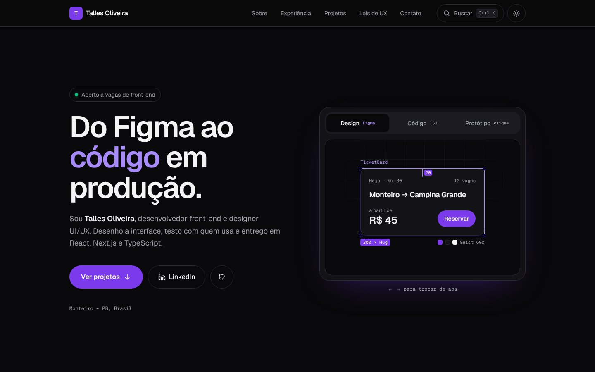

# Portfólio — Talles Oliveira

Meu portfólio pessoal como **Front-end Developer & UI/UX Designer**, feito com **Next.js, TypeScript e Tailwind CSS**.



## Destaques

- **Design ↔ Código ↔ Protótipo**: no topo, o mesmo componente aparece como frame do Figma, como TSX e funcionando de verdade
- **Paleta de comandos** (`Ctrl/⌘ K`) para navegar e abrir links pelo teclado, também acessível pelo botão "Buscar"
- **Leis de UX aplicadas e demonstradas**: ao clicar numa lei (Fitts, Hick, Jakob, Miller, Von Restorff, Doherty), o site rola até onde ela foi usada e destaca o elemento
- **Tema claro e escuro** que segue o sistema, sem piscar na primeira carga
- **Filtro de projetos**, destaque que acompanha o mouse nos cards e scroll-spy no menu
- **Acessível**: navegação completa por teclado, link "pular para o conteúdo", contraste AA, alvos de toque de 44 px e respeito a `prefers-reduced-motion`
- **App Router do Next.js** com a página gerada de forma estática (SSG)
- **Conteúdo tipado** em `lib/data.ts`: experiências, projetos e stack ficam separados dos componentes, então atualizar o portfólio é só editar um arquivo
- **Componentes reutilizáveis** (`Header`, `Section`, `ProjectCard`)
- **Responsivo e acessível**: HTML semântico, foco visível no teclado e contraste alto
- **SEO**: metadados e Open Graph configurados no layout

## Tecnologias

Next.js 16 · React 19 · TypeScript · Tailwind CSS 4 · ESLint

## Como rodar

```bash
git clone https://github.com/talles1x/portfolio.git
cd portfolio
npm install
npm run dev
```

Acesse `http://localhost:3000`.

## Estrutura

```
app/
├── layout.tsx      # fontes, metadados e SEO
├── page.tsx        # seções da página
└── globals.css     # tema (cores e tipografia)
components/
├── Header.tsx          # menu com scroll-spy e barra de progresso
├── CommandPalette.tsx  # Ctrl/⌘ K
├── DesignCode.tsx      # Design ↔ Código ↔ Protótipo
├── Projects.tsx        # filtro de projetos
├── ProjectCard.tsx
├── UxLaws.tsx          # leis de UX que destacam elementos da página
├── ThemeToggle.tsx
├── Section.tsx
└── Icons.tsx
lib/
├── data.ts         # conteúdo tipado do portfólio
└── theme.ts        # tema, paleta e destaque das leis de UX
```
